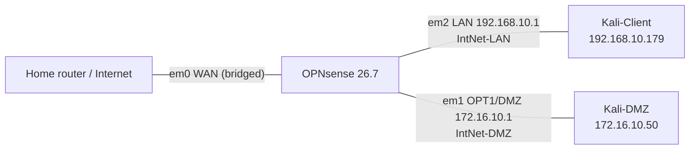

# OPNsense Network Security Labs

Labs from COMP 3500 Network Security at Wentworth Institute of Technology. All labs are run on an OPNsense firewall in VirtualBox with Kali Linux VMs as the clients.

Testing was done in an isolated virtual lab against my own VMs.

## Lab Environment

VirtualBox 7.2.16 on a Windows 11 host.

| VM | Role | Interface / Network | IP |
|---|---|---|---|
| OPNsense 26.7 | Firewall / router | em0 WAN (Bridged) | DHCP from home router |
| | | em1 OPT1/DMZ (`IntNet-DMZ`) | 172.16.10.1/24 |
| | | em2 LAN (`IntNet-LAN`) | 192.168.10.1/24 |
| Kali-Client | LAN client | `IntNet-LAN` | 192.168.10.179 (DHCP from OPNsense) |
| Kali-DMZ | DMZ client | `IntNet-DMZ` | 172.16.10.50 (static) |

## Topology

## Labs

| # | Lab | Topic | Status |
|---|---|---|---|
| 0 | Environment Setup | VirtualBox networking, OPNsense install, Kali clients | Pending |
| 1 | Firewall Rules | Aliases, rule actions, admin SSH access rule | Pending |
| 2 | [Firewall Rules Between Zones](lab02-firewall-rule-design/) | Inter-zone policy (LAN/DMZ/WAN), DNS rule design | Partial, redo planned |
| 3 | NGFW (Zenarmor) | Layer 7 application and web filtering | Pending |
| 4 | Suricata IDS/IPS | Rulesets, policies, detection vs. prevention | Pending |
| 5 | [Suricata Rules for Nmap](lab05-suricata-nmap-rules/) | Custom and community signatures detecting Nmap scans | Done |
| 6 | DNS Redirect | Destination NAT forcing DNS through the firewall | Pending |

## How I Document Each Lab

1. Take notes while doing the lab: what I did, what I expected, what actually happened.
2. Screenshot each notable configuration step.
3. Test the result from a Kali client and screenshot the proof (firewall live log or IDS alerts).
4. Export the OPNsense config and remove passwords and keys from it with `tools/scrub_config.py`.
5. Write the lab's README from the notes.

Each lab folder has its own README, screenshots, and scrubbed `config.xml`.