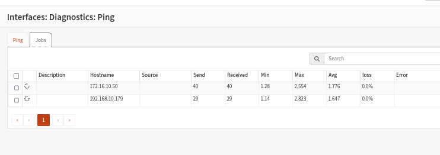
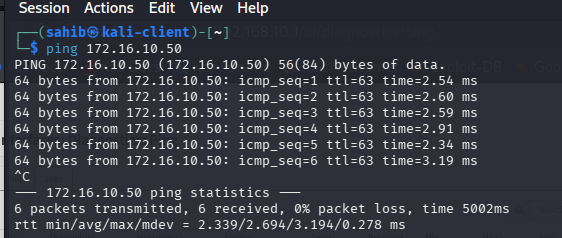
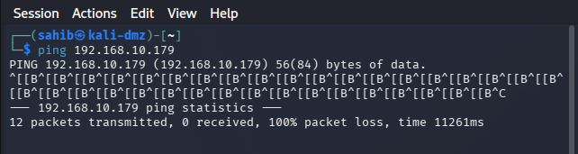

# Lab 2: Firewall Rules Between Zones

**Status:** partial. The inter-zone tests below are done and verified. The DNS rule set is designed but not traffic-tested, and one rule has an open issue. A full redo is planned.

## Objective

Find out what OPNsense allows between the LAN and the DMZ by default, explain why, and design a firewall rule set for DNS across three zones (WAN, LAN, DMZ).

## Environment

| Item | Value |
|---|---|
| Firewall | OPNsense 26.7 |
| LAN client | Kali-Client, 192.168.10.179, gateway 192.168.10.1 (em2) |
| DMZ client | Kali-DMZ, 172.16.10.50, gateway 172.16.10.1 (em1) |

Kali-DMZ is a linked clone of Kali-Client with new MAC addresses, attached to the DMZ internal network. There is no DHCP on the DMZ, so I set its address by hand:

```
sudo nmcli con mod "Wired connection 1" ipv4.method manual ipv4.addresses 172.16.10.50/24 ipv4.gateway 172.16.10.1 ipv4.dns 172.16.10.1
sudo nmcli con up "Wired connection 1"
```

## What I Tested

### 1. The firewall can ping both clients



Both pings got 0% loss. Traffic that starts from the firewall itself isn't checked against the interface rules. An automatic rule lets the firewall's own traffic out, and the replies are allowed back because they match the connection state that was created.

The difference between the two is the path. The ping to the DMZ client leaves em1 with source 172.16.10.1. The ping to the LAN client leaves em2 with source 192.168.10.1.

### 2. LAN to DMZ works



The default "allow LAN to any" rule passes it. The replies come back because the firewall is stateful: it remembers the connection and allows the return traffic without a separate rule. `ttl=63` shows the packet crossed one router (it starts at 64 and OPNsense subtracts one).

### 3. DMZ to LAN is blocked



100% loss with no error message. No error means the packets were dropped silently instead of rejected. The DMZ interface has no pass rules, so everything arriving on it hits the default deny.

## Why DMZ to LAN Stays Blocked

The DMZ holds the servers that face the internet, so they are the most likely machines to get compromised. If the DMZ could reach the LAN, an attacker who took over a DMZ server could move from it into the internal network. Even allowing only ping would let them find which internal hosts are alive.

LAN to DMZ is the normal direction: the more trusted zone starts the connection to the less trusted one, and state handles the replies.

It only works because the DMZ is a separate subnet. Every packet between the zones has to be routed through the firewall, so the firewall sees it. If the servers were on the same subnet as the LAN, they would talk to LAN hosts directly and the firewall would never be involved.

## DNS Rule Set (Designed)

Scenario: a DNS server in the LAN (192.168.10.53) and one in the DMZ (172.16.10.53).

| # | Interface | Action | Protocol | Source → Destination | Purpose |
|---|---|---|---|---|---|
| 1 | LAN | pass | UDP | LAN net → 172.16.10.53:53 | clients query the DMZ DNS server |
| 2 | LAN | pass | TCP | 192.168.10.53 → 172.16.10.53:53 | zone transfer to the DMZ server |
| 3 | LAN | block | TCP/UDP | LAN net → any:53 | no other DNS from the LAN |
| 4 | DMZ | pass | UDP | 172.16.10.53 → not LAN net:53 | DMZ server resolves on behalf of clients |
| 5 | DMZ | pass | TCP | 172.16.10.53 → 192.168.10.53:53 | zone transfer to the LAN server |
| 6 | WAN | block | TCP | any → 172.16.10.53:53 | no zone transfers from the internet |
| 7 | WAN | pass | UDP | any → 172.16.10.53:53 | answer queries from the internet |

Notes on the design:

- Order matters on the LAN: rules 1 and 2 have to sit above rule 3, or the block would match first.
- Normal DNS queries use UDP 53. Zone transfers use TCP 53. A zone transfer hands over every record in the zone, which maps out the network, so it's limited to the two DNS servers.
- Rules are written on the interface the traffic arrives on, direction "in".

These addresses are placeholders for the scenario. There are no DNS servers running at them, so the rule set has not been tested with real traffic. Most of it was entered on the firewall as practice; rule 3 was not saved.

## Issues & Fixes

### 1. A pass rule on the DMZ interface never took effect (open)

I added a rule on the DMZ interface to pass ICMP from 172.16.10.50 to 192.168.10.179. It saved in the GUI, but the ping still failed and the live log kept showing the default deny.

What I checked from the OPNsense shell:

- `/tmp/rules.debug` (the rule file OPNsense generates) had no pass rule for the DMZ subnet.
- `pfctl -sr` (the rules actually loaded) didn't have it either.
- The same search did find the anti-spoofing rule for the LAN subnet, so the check itself was working.

So the rule was saved in the GUI but never written into the loaded rule set. In Lab 5 a rule on the same interface with protocol "any" worked, which points at something specific to how the ICMP rule was saved. Finding the cause is the first thing in the redo.

### 2. Port field rejected "DNS"

The destination port field showed "Please specify a valid port number" when I picked the port before setting the protocol. Setting the protocol to TCP or UDP first fixed it.

## Takeaways

- A firewall interface with no rules denies everything arriving on it.
- Stateful filtering means you write a rule for the direction a connection starts in. Replies are handled by the state table.
- A saved rule isn't proof of anything. Check what is loaded (`pfctl -sr`) and test with traffic.
