# Lab 5: Suricata Rules for Nmap Scan Detection

## Objective

Load custom Suricata signatures on OPNsense that detect different Nmap scan types, run those scans from the DMZ against a LAN host, and confirm the alerts show up.

## Environment

| Item | Value |
|---|---|
| Firewall / IDS | OPNsense 26.7 with Suricata in IDS mode (PCAP capture) |
| Monitored interfaces | LAN and OPT1 (DMZ) |
| Scanner | Kali-DMZ, 172.16.10.50 |
| Target | Kali-Client, 192.168.10.179 |
| Scanner tool | Nmap 7.99 |

All scans were run inside my own isolated lab against my own VM.

## What I Built

### Part A: three custom rules

Each rule matches a TCP flag combination that normal traffic doesn't produce.

```
alert tcp any any -> $HOME_NET any (msg:"ET SCAN Nmap XMAS Scan"; flags:FPU; sid:1000002; rev:1;)
alert tcp any any -> $HOME_NET any (msg:"Nmap FIN Scan"; flags:F,12; sid:1000003; rev:1;)
alert tcp any any -> $HOME_NET any (msg:"Nmap NULL Scan"; flags:0; sid:1000004; rev:1;)
```

| Scan | What Nmap sends | What the rule matches |
|---|---|---|
| XMAS (`-sX`) | FIN + PSH + URG set together | `flags:FPU` |
| FIN (`-sF`) | only FIN, with no connection open | `flags:F,12` (the `,12` means ignore the two reserved bits) |
| NULL (`-sN`) | no flags at all | `flags:0` |

I first wrote the rules into `local.rules` from the OPNsense shell:

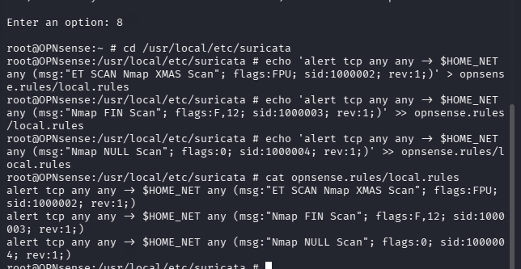

That didn't work (see Issues & Fixes #2), so I loaded them as a custom ruleset instead:

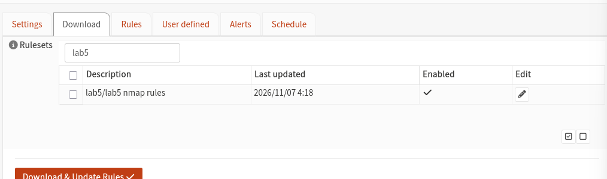

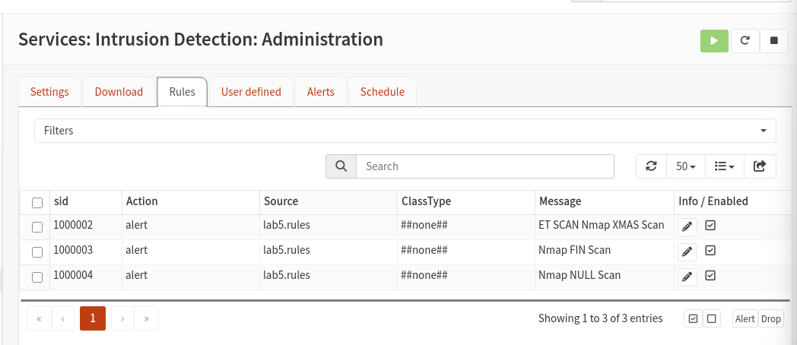

I also added a pass rule on OPT1 from 172.16.10.50 to 192.168.10.179, because the DMZ is default deny toward the LAN and the scanner needed a path to the target.

### Part B: a community ruleset

I replaced the Part A rules with the ruleset from [aleksibovellan/opnsense-suricata-nmaps](https://github.com/aleksibovellan/opnsense-suricata-nmaps). These rules use thresholds (for example 20 matching packets from one source in 70 seconds) and cover SYN, connect, ACK, XMAS, fragmented and UDP scans, plus traffic to port 4444.

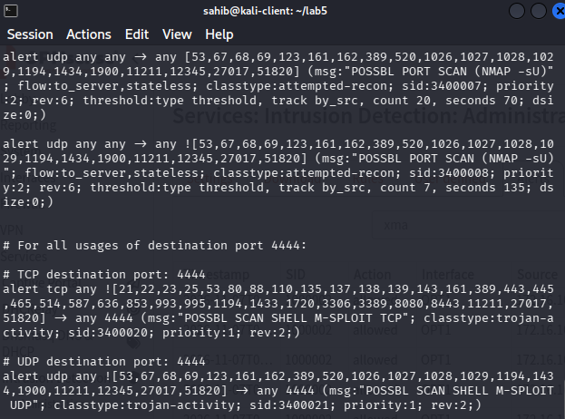

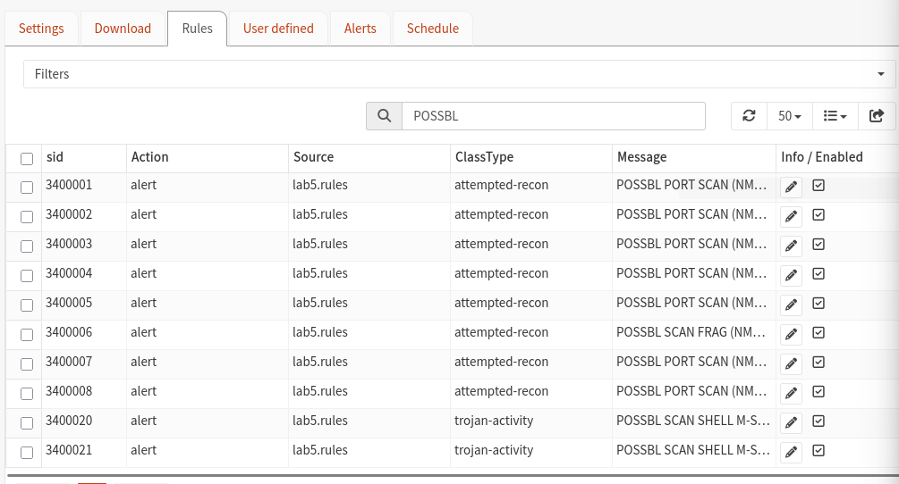

## Verification

### Part A

Scans run from Kali-DMZ:

```
sudo nmap -Pn -T4 -sX --top-ports 100 192.168.10.179
sudo nmap -Pn -T4 -sF --top-ports 100 192.168.10.179
sudo nmap -Pn -T4 -sN --top-ports 100 192.168.10.179
```

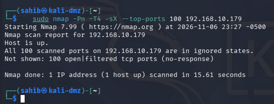

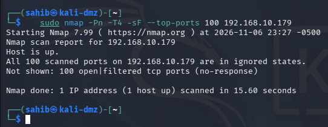

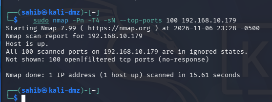

The XMAS scan produced 51 alerts for SID 1000002 on the OPT1 interface, source 172.16.10.50, destination 192.168.10.179:

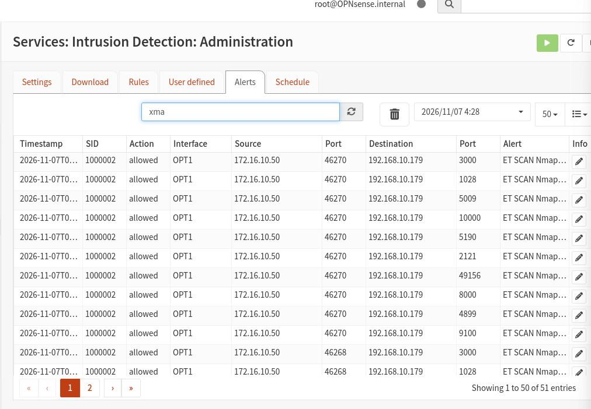

The screenshot I captured is filtered to the XMAS rule, so that is the one I can show proof for in Part A.

The action column says `allowed` because Suricata was in IDS mode. It alerts on the packet but doesn't drop it.

### Part B

```
sudo nmap -Pn -T4 -sS --top-ports 100 192.168.10.179
sudo nmap -Pn -T4 -sX --top-ports 100 192.168.10.179
sudo nmap -Pn -T4 -sU --top-ports 100 192.168.10.179
```

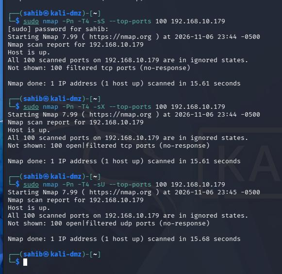

Alerts fired for the XMAS rule (SID 3400005), the UDP scan rule (SID 3400008) and the UDP port 4444 rule (SID 3400021):

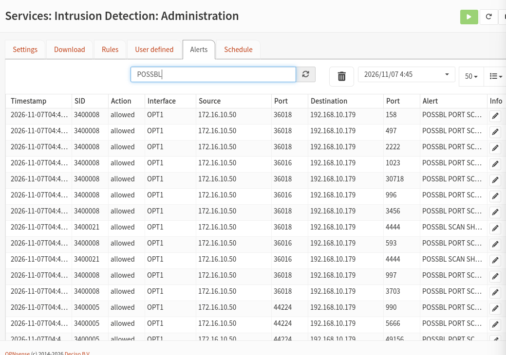

## Issues & Fixes

### 1. The firewall GUI died but ping still worked

Suricata was set to IPS mode (Netmap) from the previous lab. After that the web GUI and other TCP traffic on the LAN interface stopped working, but ping was fine. The console was printing `netmap_transmit em2 drop mbuf, needs checksum offload`.

**Cause:** the virtual NIC had checksum offloading on, so TCP packets were leaving the network stack without a finished checksum, expecting the NIC to fill it in. Netmap takes packets before the NIC does that, so they got dropped. ICMP checksums are calculated in software, which is why ping still worked.

**Fix:** stopped Suricata from the console (`configctl ids stop`), turned off checksum, TSO and LRO offloading on the interface, and switched Suricata to PCAP (IDS) mode. PCAP mode inspects a copy of the traffic, so it can't break forwarding.

### 2. Rules in `local.rules` didn't show up in the GUI

OPNsense only lists rulesets it knows about from the Download tab, and it regenerates `suricata.yaml` on its own, so editing files by hand doesn't stick.

**Fix:** registered my rules as a ruleset. I added a small metadata XML file under `/usr/local/opnsense/scripts/suricata/metadata/rules/` that points at a URL, served the rules file from Kali-Client with `python3 -m http.server 8000`, then enabled the ruleset on the Download tab and clicked Download & Update Rules.

### 3. XMAS, FIN and NULL scans produced no alerts at first

Ping from the DMZ to the LAN worked, but the flag scans hung and nothing was logged.

**Cause:** Suricata was only listening on the LAN interface. The firewall only creates a connection state for TCP that starts with a SYN. These scans don't send a SYN, so the firewall dropped them when they arrived on OPT1. They never reached the LAN side where Suricata was watching.

**Fix:** added OPT1 to Suricata's interfaces, so it sees the packets as they arrive, before the firewall drops them. That's why every alert shows interface OPT1.

## Takeaways

- **Sensor placement decides what an IDS can see.** A sensor behind the firewall only sees what the firewall lets through. To see the attempts, it has to be on the side the traffic arrives on.
- **IDS alerts, IPS blocks.** In IDS mode every alert says `allowed`. Dropping needs in-line (IPS) mode, and in-line mode is what caused the outage in issue #1.
- **`threshold: type limit` vs `type threshold`.** `limit` caps how many alerts get logged. `threshold` means "only alert after N matches". The Part B rules use `threshold`, which is why they stay quiet on normal traffic.
- **These rules are easy to evade.** A slow scan stays under the thresholds, and the flag rules only catch the obvious scan types. In a real network they'd be one layer next to a maintained ruleset.
